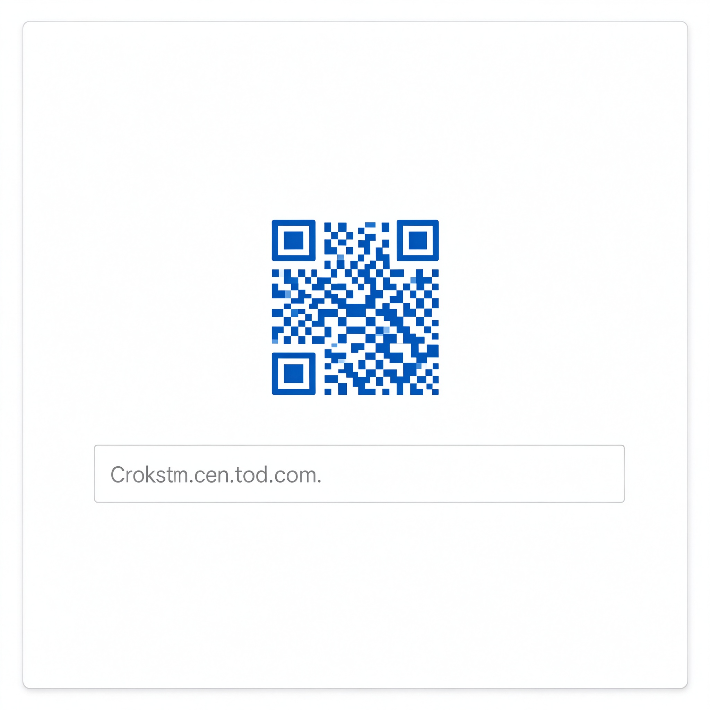
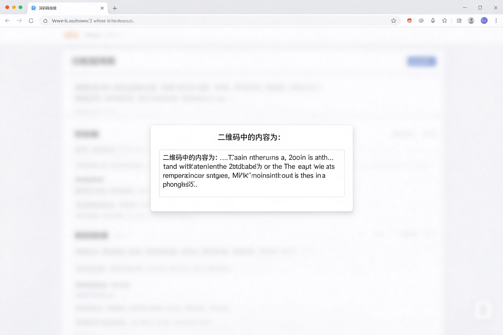

# Clean QRCode 极简二维码

[](LICENSE)
[](https://www.google.com/chrome/)
[](manifest.json)
[](https://github.com/NathanBoy/clean-qrcode/actions/workflows/ci.yml)

一个**完全本地、离线可用**的 Chrome 二维码助手扩展：把当前页面地址、选中的文本、链接或图片地址一键生成二维码，也能右键解析网页里的二维码图片内容，防止扫码中毒。



## ✨ 特性

- **完全离线**：二维码生成与解析全部在本地完成，不依赖任何远程服务，无网络请求、无广告、无数据上报
- **轻量简洁**：不常驻后台（MV3 Service Worker 按需唤醒），内存占用小，无 jQuery 等冗余依赖
- **右键生成**：对页面上任意文本、链接、图片、视频、音频地址右键，一键生成二维码
- **右键解析**：对页面中的二维码图片右键，即可解析出内容，扫码前先校验，防止扫描恶意链接中毒
- **一键复制**：生成的内容可一键复制到剪贴板
- **多语言**：内置中英文界面，随浏览器语言自动切换

## 🚀 安装

### 从源码加载（推荐，便于体验与开发）

1. 下载本仓库代码并解压
2. 打开 Chrome，地址栏输入 `chrome://extensions` 回车
3. 打开右上角「开发者模式」开关
4. 点击「加载已解压的扩展程序」，选择项目文件夹
5. 扩展出现在工具栏后即可使用

> 需要 Chrome 109 及以上版本（基于 Manifest V3）。

## 🎯 使用说明

### 工具栏按钮

点击工具栏的扩展图标，弹窗内即为当前页面地址的二维码，点击输入框可一键复制该地址，方便在手机、平板等移动设备上继续浏览。


### 右键菜单

- **生成二维码图片**：右键任意文本、链接、图片、音视频地址，选择「生成二维码图片」，即在页面上弹出对应二维码
- **解析二维码内容**：右键页面上的二维码图片，选择「解析二维码内容」，即可查看其中内容，扫码前先确认，防止误扫恶意链接



## 🧰 技术概览

| 模块 | 说明 |
| --- | --- |
| 二维码生成 | [JSQRGen](https://github.com/gera2ld/jsqrgen)（本地 Canvas 绘制） |
| 二维码解析 | [ZXing](https://github.com/zxing/zxing)（JS 移植版，本地解析） |
| 架构 | Manifest V3，`action` 弹窗 + `contextMenus` 右键菜单 + `content_scripts` 页内弹层 + `service_worker` 后台 |
| 依赖 | 仅两个内置压缩库，无运行时外部依赖 |

## 📁 项目结构

```
clean-qrcode/
├── manifest.json          # MV3 清单
├── background.js          # Service Worker：右键菜单注册与分发
├── popup.html             # 工具栏弹窗
├── lib/
│   ├── qrgen.min.js       # 二维码生成库
│   ├── zxing.min.js       # 二维码解析库
│   ├── qrcode_option.js   # 二维码样式配置
│   ├── content.js         # 页内弹层：渲染/解析二维码
│   └── popup.js           # 弹窗逻辑
├── icon/                  # 扩展图标
├── res/                   # 文档配图
└── _locales/              # 中英文语言包
```

## 🔧 开发

```bash
# 项目无需构建，直接作为已解压扩展加载即可
# 修改后到 chrome://extensions 点击扩展的「刷新」按钮生效
```

代码保持零依赖、零构建，可直接阅读和修改。

## 📄 许可

[MIT](LICENSE) © [NathanBoy](https://github.com/NathanBoy)

---

> **致谢**：本项目从早期开源的 Chrome 二维码插件（atool.org 的 chrome-qrcode）演进而来，并使用了 [JSQRGen](https://github.com/gera2ld/jsqrgen) 与 [ZXing](https://github.com/zxing/zxing) 两个开源库。在此对原项目及库的作者表示感谢。
